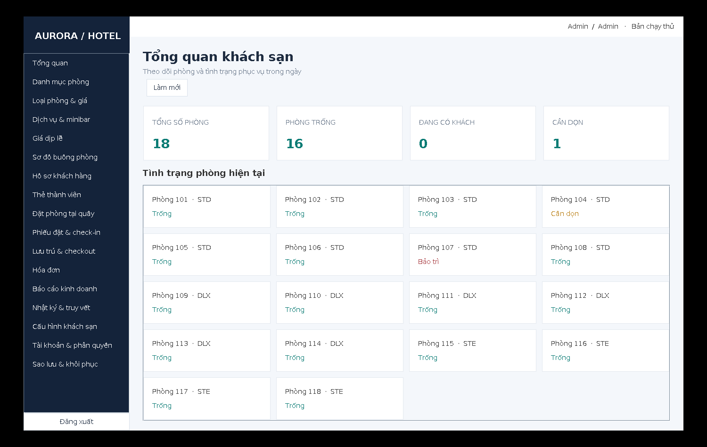

# HotelManager OOAD — Java Desktop

Ứng dụng quản lý khách sạn bằng **Java 17 + Swing**, gồm hai module `backend` và `frontend`. Bản đầu phục vụ xem xét giao diện và chạy thử nghiệp vụ; dữ liệu được lưu cục bộ, không phải hệ thống triển khai nhiều máy.



## Chạy trên Windows

1. Cài **JDK 17 hoặc mới hơn**, kiểm tra `java -version` và `javac -version`.
2. Tải repository, giải nén; mở `run.bat`. Hoặc mở thư mục gốc trong IntelliJ/VS Code và chạy `vn.hotel.app.HotelApplication` sau khi biên dịch cả hai module.
3. Không cần MySQL, Maven hay tải thư viện ngoài để chạy bằng script.

Linux/macOS: `bash run.sh`. Nếu dùng Maven: `mvn package` ở thư mục gốc, sau đó chạy main với classpath gồm hai module. Các script là đường chạy đã kiểm thử trong phiên tạo mã.

## Tài khoản thử nghiệm

| Tên đăng nhập | Vai trò | Mật khẩu |
|---|---|---|
| admin | Admin | Demo@123 |
| manager | Quản lý | Demo@123 |
| reception | Lễ tân | Demo@123 |
| housekeeping | Buồng phòng | Demo@123 |
| customer | Khách hàng | Demo@123 |

Dữ liệu mẫu được tạo **một lần** khi chưa có tài khoản. Dữ liệu phát sinh lưu vào `data/hotel.bin`. Không chạy nhiều tiến trình cùng dùng file này. Để thử lại từ đầu, sao lưu rồi đổi tên file dữ liệu; ứng dụng tạo bộ demo mới. Không dùng thông tin cá nhân hoặc mật khẩu thật.

## Cấu trúc

```text
backend/src/main/java/vn/hotel/
  api/           Điểm ghép backend
  domain/        Các thực thể và trạng thái nghiệp vụ
  dto/           Phiên, bảng kê và dữ liệu tài khoản an toàn
  service/       Các nghiệp vụ phòng, khách, đặt, thanh toán, dọn và quản trị
  security/      Băm mật khẩu, phiên, phân quyền và OTP demo
  repository/    Cổng lưu trữ và triển khai bằng file
  bootstrap/     Dữ liệu mẫu
  exception/     Lỗi nghiệp vụ
backend/src/test/java/      Kiểm thử tích hợp
frontend/src/main/java/vn/hotel/
  app/           Main
  controller/    Điều phối phiên và chuyển màn hình
  view/          Mỗi màn hình một file
  ui/            Bảng, biểu mẫu và theme dùng chung
docs/            Kiến trúc, danh mục file, ánh xạ SQ, giới hạn và hướng dẫn thử
scripts/         Biên dịch và kiểm thử
run.bat          Chạy Windows
run.sh           Chạy Linux/macOS
```

Mỗi file Java có chú thích trách nhiệm. Xem [danh mục file](docs/FILE_GUIDE.md) và [kiến trúc](docs/ARCHITECTURE.md).

## Thử nhanh

Đăng nhập `reception` → **Phiếu đặt & check-in** → chọn `DPDEMO01` → nhập giấy tờ → nhận phòng. Mở **Lưu trú & checkout** → xem bảng kê → chọn phương thức → chỉ xác nhận sau khi giả lập nhận đủ tiền. Hóa đơn xuất hiện tại **Hóa đơn**; phòng chuyển Cần dọn. Đăng nhập `housekeeping` → **Sơ đồ buồng phòng** → chọn phòng → xác nhận dọn xong.

Các bảng có tìm kiếm, phân trang, CSV và in. Hóa đơn có cửa sổ in riêng. Muốn PDF, chọn máy in **Microsoft Print to PDF** hoặc máy in PDF khác của hệ điều hành; ứng dụng chưa có bộ xuất PDF độc lập.

## Phạm vi bản đầu

Đã có giao diện cho 5 vai trò và các nhóm nghiệp vụ trong tài liệu mới. Luồng chính chạy với lưu trữ file: đăng ký/đăng nhập, danh mục, giá lễ, hồ sơ/thẻ, đặt phòng, cọc thủ công, nhận/đổi phòng, checkout, hóa đơn, dọn phòng, tài khoản/quyền, nhật ký, báo cáo doanh thu, sao lưu và khôi phục.

**Mô phỏng hoặc chưa hoàn thiện:** SMS OTP, VietQR/webhook ngân hàng, SQL/JDBC, tính phí giờ/qua đêm và trả trễ, liên kết dịch vụ theo mã loại phòng, dịch vụ phát sinh, đặt nhiều phòng, xuất XLSX/PDF trực tiếp, logo/ảnh được sao chép vào kho quản lý. Giá demo đặt phòng tính theo ngày/đêm dựa vào `dailyPrice`; hai giá khác được lưu và hiển thị để triển khai sau. Xem [ma trận phạm vi](docs/TRACEABILITY.md).

Chạy `bash scripts/test.sh` để biên dịch và kiểm tra tích hợp. Giao diện được kiểm tra riêng trên màn hình ảo khi phát triển.

## SQL Server và cấu hình từng máy

Đã có bộ 3 script tại [database](database/README.md): `001_create_database.sql`, `002_constraints_and_logic.sql`, `003_seed_demo_data.sql`. Chạy theo thứ tự trong SSMS để tạo 22 bảng, cài ràng buộc/nghiệp vụ và chèn dữ liệu giả (60 phòng, 120 khách, 240 phiếu đặt, 150 hóa đơn).

Mỗi thành viên chạy `configure-db.bat`, sửa `config/database.properties`, thêm Microsoft JDBC JAR vào `lib/`, rồi chạy `check-db.bat` để kiểm tra kết nối. Hướng dẫn tạo login SQL, bật TCP/IP/cổng và quyền nằm trong `database/README.md`.

Đường chạy Swing hiện vẫn dùng `FileHotelRepository`; utility kết nối SQL tách riêng để hoàn thiện JDBC sau. Không nhầm `Demo@123` của bảng tài khoản ứng dụng với mật khẩu login SQL trên từng máy.
